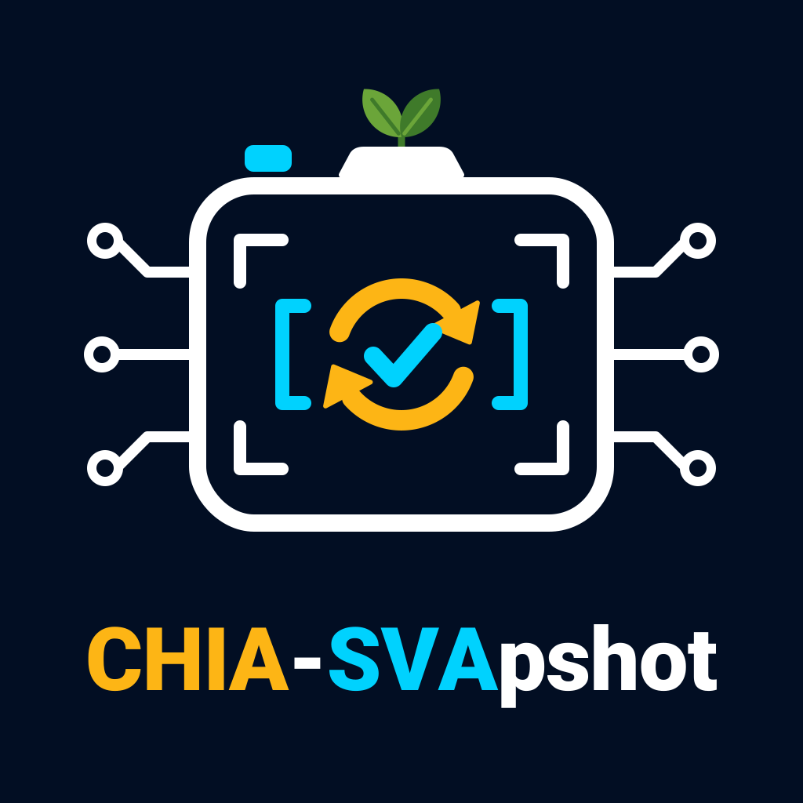

# CHIA-SVApshot

<p align="center">
  
</p>

CHIA-SVApshot runs an LLM-driven RTL optimisation loop on top of [CHIA](https://docs.chialoops.ai).
The loop generates SystemVerilog assertions (SVA) for a design with SVApshot, freezes the proved
assertions as a snapshot, asks an LLM to rewrite the RTL, re-proves the snapshot on every rewrite, and
measures the result with Yosys and an equivalence check.

This repository serves four purposes:

| # | Purpose | Entry point |
|---|---|---|
| 1 | Run the CHIA loop on your own RTL with your own LLM provider | `scripts/run_loop.sh` |
| 2 | Reproduce the FPV results (proofs and coverage) with VC Formal | `reproduce/fpv.py` |
| 3 | Reproduce the synthesis results with Yosys and Sky130 | `reproduce/synth.py` |
| 4 | Reproduce the LEC results with Yosys EQY | `reproduce/lec.py` |

## Quick start for the reproductions

```bash
git clone <this repository> && cd chia-svapshot
scripts/install_oss_cad_suite.sh            # Yosys 0.68, EQY, SAT solvers -> toolchains/

python3 reproduce/synth.py                  # 3: Sky130 area and generic gate counts (about 1 minute)
python3 reproduce/lec.py tlb --jobs 2       # 4: Yosys EQY equivalence checks
python3 reproduce/fpv.py                    # 2: VC Formal proofs and coverage (needs a license)
```

The scripts print expected against measured values and exit with 0 on a match. Flags select the RTL
(`--rtl original|optimised|custom|both|all`, `--rtl-dir DIR` for your own files), open graphical views
(`--gui`), and choose where VC Formal runs (`--docker NAME`, `--no-docker`). The full reference is in
[`reproduce/README.md`](reproduce/README.md).

## The loop

```
stage DUT -> VC Formal elaboration -> Yosys baseline -> SVApshot generate and freeze
          -> LLM rewrite (ports frozen; modes optimise, expand, trim)
          -> retain snapshot -> re-prove -> Yosys candidate -> EQY comparison
```

Every node is a `@ChiaFunction` with a resource label (`svapshot_cpu`, `formal`, `yosys`, `llm`), so Ray
schedules VC Formal licenses, LLM calls and CPU work independently.

### Setup

```bash
python3 -m venv .venv && .venv/bin/pip install -r requirements.txt     # Python 3.10 or newer
scripts/install_oss_cad_suite.sh
SVAPSHOT_REPO_URL=<SVApshot git URL> scripts/install_svapshot.sh        # clones external/svapshot
export VC_FORMAL_HOME=/path/to/vc_static/X-2025.06-SP2                  # real runs only
export SNPSLMD_LICENSE_FILE=<port>@<license host>                       # real runs only
```

### Dry run

The dry run replays synthetic payloads through the full graph on any machine that has the Python packages installed:

```bash
scripts/run_loop.sh --design div_unit
```

### Real run on the bundled designs

```bash
export OPENAI_API_KEY=...
scripts/run_loop.sh --real --design ptw --llm openai:gpt-5
```

### Real run on your own RTL

1. Copy `configs/targets.template.yaml` to `configs/my_targets.yaml` and list your source files.
2. Export `DUT_ROOT` (the folder that holds your RTL).
3. Start the loop:

```bash
scripts/run_loop.sh --real --targets configs/my_targets.yaml --design my_block \
    --llm vertex:gemini-2.5-pro --sva-llm gemini-2.5-pro
```

`--llm` drives the RTL rewrite and the expand follow-up; `--sva-llm` drives the SVApshot assertion
generator (default: the value of `--llm`).

### LLM providers

A model reads `provider:model`. A bare model name picks its provider from the name.

| Provider | Example | Environment |
|---|---|---|
| `openai` | `openai:gpt-5` | `OPENAI_API_KEY`; `OPENAI_BASE_URL` selects any server that speaks `/chat/completions` (vLLM, Ollama, LiteLLM, llama.cpp) |
| `anthropic` | `anthropic:claude-sonnet-4-5` | `ANTHROPIC_API_KEY` |
| `vertex` | `vertex:gemini-2.5-pro` | `GOOGLE_CLOUD_PROJECT` and gcloud application-default credentials (`pip install google-genai`) |
| `gemini` | `gemini:gemini-2.5-flash` | `GEMINI_API_KEY` or `GOOGLE_API_KEY` |
| `nvidia` | `nvidia:meta/llama-3.3-70b-instruct` | `NVIDIA_API_KEY` |
| `mock` | `mock:replay` | `CHIA_LLM_MOCK_FILE` (canned reply for tests) |

`CHIA_LLM_MAX_TOKENS` caps the reply length for every provider.

### Cluster

`configs/cluster.yaml` declares the logical workers. The `formal` worker count equals the number of VC
Formal licenses you own.

```bash
chia up configs/cluster.yaml
chia job submit --working-dir . -- python chia_ppa_loop.py --real --llm <provider:model> --ray-address auto
```

## Layout

| Path | Content |
|---|---|
| `chia_ppa_loop.py` | command line of the loop |
| `chia_svapshot/` | loop nodes, LLM layer, state classes |
| `chia_svapshot/tools/` | wrappers for Yosys, EQY, VC Formal and SVApshot |
| `chia_svapshot/analysis/` | cone-of-influence analysis and proof-status parsing |
| `configs/` | RTL targets, dry-run switches, cluster definition |
| `reproduce/` | reproduction scripts, shipped RTL cases, reference values |
| `pdk/sky130/` | Sky130 high-density Liberty file used by the synthesis judge |
| `scripts/` | installers and launchers |
| `docs/architecture.md` | nodes, resources, workers and cluster of the CHIA loop |
| `tests/` | unit tests (`make test`) |

See [`NOTICE`](NOTICE) for the origin of the shipped RTL and library files.
