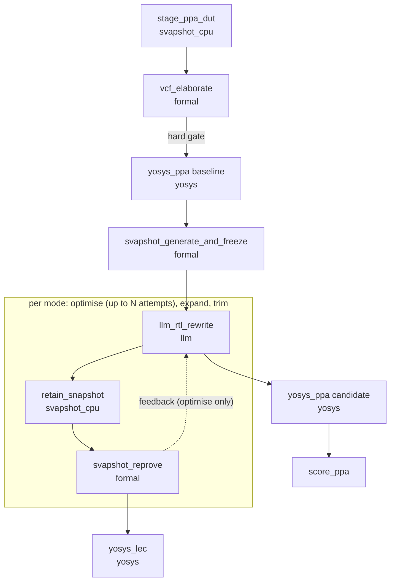

# Architecture of the CHIA loop

This document describes how the loop in `chia_ppa_loop.py` maps onto [CHIA](https://docs.chialoops.ai):
the nodes, their resource labels, the data they exchange, the workers of a cluster, and the places where
each tool runs.

## 1. What the loop does

One design under test (DUT) goes through a fixed pipeline:

1. A VC Formal elaboration gate accepts or rejects the RTL.
2. Yosys measures the baseline area and logic depth.
3. SVApshot generates SystemVerilog assertions (SVA) and freezes the ones that prove non-vacuously. That
   frozen set is the **snapshot**.
4. For each of three rewrite modes (`optimise`, `expand`, `trim`) an LLM rewrites the RTL with the port list
   frozen. The loop keeps the snapshot properties that still describe the rewritten module (**retain**),
   re-proves them with VC Formal (**reprove**), measures the new area and depth with Yosys, and compares
   with the baseline (**score**).
5. A rewrite that keeps the snapshot green receives an observational equivalence check with Yosys EQY.

Two outcomes carry the paper's argument: a rewrite with better Yosys results and a passing snapshot, and a
rewrite that breaks the snapshot. A snapshot-clean rewrite that EQY rejects shows that the equivalence
check is stricter than the snapshot.

| Term | Meaning |
|---|---|
| Snapshot | the assertions of a DUT that VC Formal proved with a reachable antecedent (non-vacuous); capped at 50 (`SVAPSHOT_MAX_ASSERTIONS`) |
| Retain | a static filter that keeps each snapshot assertion whose signals all exist in the rewritten module |
| Reprove | VC Formal run of the retained assertions on the rewritten module; passes when every retained assertion proves |
| PPA win | relative change `(candidate - baseline) / baseline` improves the goal axis and stays within `max_regression` (default 5%) on the other axis |
| Port freeze | the rewrite keeps the module's port list; a changed list ends the attempt |

## 2. CHIA concepts the loop uses

| CHIA element | Role in the loop |
|---|---|
| `@ChiaFunction(resources={...})` | declares one schedulable unit; the decorator turns a Python function into a Ray task that requests the listed resource units |
| `fn.chia_remote(...)` | dispatches the task and returns an `ObjectRef` at once |
| `ObjectRef` as an argument | the edge of the graph; Ray starts the consumer when the producer finishes |
| `get(ref)` | blocks the driver until the value is available |
| `_chia_tag` | label of one call (`optimise_rw0`); the bypass patterns and the profiler read it |
| `Bypass(yaml_path)` | replaces the body of named nodes with provider functions; the scheduling stays real |
| `chia.trace.profiler` | optional trace collector (`--profile-dir`) |

`chia_svapshot.state.unwrap` strips the wrapper object that the profiler puts around a node result, so
each node calls it on every argument that arrives from another node.

## 3. The node catalogue

Nine `@ChiaFunction` nodes live in `chia_svapshot/ppa_nodes.py`.

| Node | Resource | Input | Output | Work |
|---|---|---|---|---|
| `stage_ppa_dut` | `svapshot_cpu` | target name, workspace | `PpaDesign` | copies the RTL, splits packages from modules, extracts the port list, resolves `match_instance` parameters |
| `vcf_elaborate` | `formal` | `PpaDesign` | `ElabResult` | `vcf` analyze and elaborate; the hard gate |
| `yosys_ppa` | `yosys` | `PpaDesign` or `RewriteResult`, label | `PpaMeasure` | Yosys `synth`, `stat`, `ltp` with the Sky130 Liberty (cells, wires, levels, area in um^2) |
| `svapshot_generate_and_freeze` | `formal` | `PpaDesign`, baseline `PpaMeasure` | `FrozenSnapshot` | SVApshot writes and repairs the SVA, VC Formal proves them, the proved non-vacuous set is frozen |
| `llm_rtl_rewrite` | `llm` | `PpaDesign`, attempt, feedback, model, seed, goal, mode | `RewriteResult` | one LLM call; extracts the module; rejects a changed port list |
| `retain_snapshot` | `svapshot_cpu` | `PpaDesign`, `FrozenSnapshot`, `RewriteResult` | `RetainResult` | identifier-set filter over the snapshot assertions (`--retain-mode exists\|touched`) |
| `svapshot_reprove` | `formal` | `PpaDesign`, `RewriteResult`, `RetainResult` | `ReproveResult` | VC Formal proof of the retained assertions on the candidate |
| `score_ppa` | default CPU | `PpaDesign`, baseline and candidate `PpaMeasure` | `PpaScore` | compares candidate and baseline; applies the goal and the regression tolerance |
| `yosys_lec` | `yosys` | `PpaDesign`, `RewriteResult`, `ReproveResult` | `LecResult` | EQY gold against gate (`[strategy simple] use sat; depth 10`); runs after a snapshot-clean rewrite |

`score_ppa` is a pure comparison; Ray schedules it with its default CPU request.

## 4. The graph



### Dispatch order in the driver

`_run_one` and `_run_mode` in `chia_ppa_loop.py` issue the calls below. A name in parentheses is an
argument that is an `ObjectRef`.

```
dut     = stage_ppa_dut(name, workspace, targets)
elab    = vcf_elaborate(dut)                          get(dut, elab)      -> gate 1
base    = yosys_ppa(dut, "baseline", elab)            get(base)           -> gate 2
snap    = svapshot_generate_and_freeze(dut, base)     get(snap)           -> gate 3

for mode in modes:                                    # sequential
    for attempt in range(budget):                     # budget = --rewrite-attempts for optimise, 1 otherwise
        rw  = llm_rtl_rewrite(dut, attempt, feedback, model, seed, goal, mode)
        ret = retain_snapshot(dut, snap, rw)
        rep = svapshot_reprove(dut, rw, ret)          # rw, ret, rep dispatch back to back
        get(rw, ret, rep)
        if rep.ok: break
        feedback = rep.feedback or rw.reason
    cand  = yosys_ppa(rw, "candidate_<mode>", rw)     # when rw.ok and ports_ok
    score = score_ppa(dut, base, cand)
    lec   = yosys_lec(dut, rw, rep)                   # when rep.ok
```

The three rewrite nodes of one attempt form a chain whose edges stay inside Ray. The driver blocks on
`get` after each entry-gate stage and after each attempt, because it reads the values to decide the next
step.

## 5. Control flow and gates

| Point | Rule |
|---|---|
| Elaboration | one attempt; a failure ends the design with reason "VC Formal elaborate failed (hard gate)" |
| Baseline Yosys | a failure ends the design |
| Snapshot generation | `snapshot_worthy > 0` and a property file are required; otherwise the design ends |
| Rewrite | an LLM error, a reply with an incomplete module, or a changed port list marks the attempt rejected |
| `optimise` | up to `--rewrite-attempts` attempts (default 3); a failed reprove hands `ReproveResult.feedback` to the next prompt |
| `expand`, `trim` | one attempt; a failing reprove is recorded as a result |
| Reprove | passes when the ports match, at least one assertion was retained, zero failed, and every retained assertion proved |
| Score | win when the goal axis improves (`area`, `delay`, or `area_or_delay`) and the other axis stays within `max_regression` |
| EQY | observational; the verdict lands in the report and leaves the loop result unchanged |

The mode outcome is one of `rewrite_rejected`, `snapshot_fail`, `ppa_win_snapshot_pass`, or
`snapshot_pass_no_ppa`. The driver prints the headline cases "better PPA and passing snapshot", "failing
snapshot on new design", and "snapshot-clean rewrite failed LEC".

### Expand follow-up

After a snapshot-clean `expand`, the driver calls `expand_coverage_step` in its own process. The LLM
describes the capability that the rewrite added and writes new assertions. A new assertion survives when
its cone of influence covers a signal that the frozen snapshot left unobserved. This step is observational,
so an exception is reported and the mode continues.

## 6. Resources and scheduling

A resource label is a named counter. A node that declares `resources={"formal": 1}` runs only when a worker
offers one free `formal` unit, so the label limits concurrency of a scarce thing.

| Label | One unit equals | Nodes | Local default | `configs/cluster.yaml` |
|---|---|---|---|---|
| `formal` | one VC Formal license seat | `vcf_elaborate`, `svapshot_generate_and_freeze`, `svapshot_reprove` | 1 | 1 |
| `llm` | one concurrent LLM request slot | `llm_rtl_rewrite` | 2 | 2 |
| `yosys` | one Yosys or EQY process | `yosys_ppa`, `yosys_lec` | 2 | 2 |
| `svapshot_cpu` | one light CPU task | `stage_ppa_dut`, `retain_snapshot` | 4 | 4 |

The local defaults come from `ray.init(resources={"svapshot_cpu": 4, "llm": 2, "formal": 1, "yosys": 2})`
in `chia_ppa_loop.py`. Set the `formal` count to the number of seats you own.

Facts that shape the capacity:

* The driver runs designs one after another and the modes of a design one after another, so one loop
  invocation keeps at most one node of the main chain busy. The labels act as admission control when
  several loops share a cluster (several `chia job submit` calls) and when you add fan-out.
* `svapshot_generate_and_freeze` holds its `formal` unit for the whole generation. SVApshot calls its LLM
  inside that node, so the `llm` label limits only the rewrite calls and the `formal` count limits the
  assertion generation.
* EQY solvers use about 1.3 GB each; `CHIA_LEC_JOBS` (default 4) sets the solver count per check.

## 7. The cluster

`configs/cluster.yaml` declares one head and four logical worker types.

```
head   ray start --head --port=6379        driver: python chia_ppa_loop.py --ray-address auto
 |
 +-- chia_cpu     {svapshot_cpu: 4}        stage, retain
 +-- chia_llm     {llm: 2}                 LLM rewrite calls
 +-- chia_formal  {formal: 1}              VC Formal (needs VC_FORMAL_HOME on the host)
 +-- chia_yosys   {yosys: 2}               Yosys and EQY (OSS CAD Suite)
```

| Worker type | Resources | Setup |
|---|---|---|
| `chia_cpu` | `svapshot_cpu: 4` | sources `scripts/env.sh` |
| `chia_llm` | `llm: 2` | sources `scripts/env.sh`; the provider keys reach the worker through the runtime environment |
| `chia_formal` | `formal: 1` | checks `VC_FORMAL_HOME`, sources `scripts/env.sh` |
| `chia_yosys` | `yosys: 2` | sources `scripts/env.sh`, which puts `toolchains/oss-cad-suite/bin` on `PATH` |

All four types list `compatible_ips: ["${THIS_MACHINE}"]`, so the file splits one machine into logical
workers. Pointing `compatible_ips` at other hosts places each class on its own machine (the license host
for `chia_formal`, a larger machine for `chia_yosys`).

```bash
export THIS_MACHINE=$(hostname -I | awk '{print $1}')
export CHIA_ROOT=$PWD
chia up configs/cluster.yaml
chia job submit --working-dir . -- python chia_ppa_loop.py --real --llm <provider:model> --ray-address auto
```

Requirements for a multi-machine cluster:

* **Shared filesystem.** Nodes pass paths (the workspace, the RTL tree, the property file), so every
  worker sees the repository, the workspace root, and the `snapshot_library/` at the same path.
* **Environment.** The driver forwards variables with these prefixes to every worker through Ray's
  `runtime_env`: `CHIA_`, `SVAPSHOT_`, `GOOGLE_`, `GCLOUD_`, `GEMINI_`, `OPENAI_`, `NVIDIA_`, `ANTHROPIC_`,
  `SNPS`, `VC_`, `YOSYS`, `EQY`, `DUT_ROOT`, `TERMINFO`, plus `PYTHONPATH` and `PATH`.
* **Tools on the worker that owns the label.** `formal` workers need VC Formal and a license; `yosys`
  workers need the OSS CAD Suite; `llm` workers need network access to the provider.

A single machine runs through `scripts/run_loop.sh`, which starts a local Ray instance with the default
resources above.

## 8. Where each tool runs

| Step | Process | Tool |
|---|---|---|
| Staging | Ray worker | Python (`stage_ppa_dut`, `ppa_rtl.extract_ports`) |
| Elaboration and reprove | Ray worker | `vcf` on the host, or in a container through `docker exec` (`CHIA_VCF_DOCKER`, see `reproduce/README.md`) |
| Assertion generation | subprocess of the worker | SVApshot `main.py` under `SVAPSHOT_PYTHON`, in an isolated run root |
| Reprove stages | the worker process | `_stage_driver.stage_scaffold` and `stage_formal`, working directory set to the run root for the stage |
| RTL rewrite | Ray worker | HTTPS call through `chia_svapshot/llm.py` (`vertex`, `gemini`, `openai`, `nvidia`, `anthropic`, `mock`) |
| PPA and LEC | Ray worker | Yosys with yosys-slang, EQY, OSS CAD Suite |
| Expand follow-up | driver process | `llm.generate` and the cone-of-influence analysis |

SVApshot works relative to its working directory and writes `ft_<module>/` and `vcf_projs/` there. The
helper `chia_svapshot/workspace.py` builds a **run root** per snapshot: a directory that symlinks every
read-only file and support folder of the SVApshot checkout, so reads reach the live checkout and every
write lands in the run root. Two snapshots of one checkout therefore write to separate trees.

The generator reads its model from `CHIA_SVA_LLM` (default: the value of `CHIA_LLM`). `--llm` drives the
rewrite and the expand follow-up, and `--sva-llm` drives the generator.

## 9. Data model

The nodes exchange dataclasses from `chia_svapshot/ppa_state.py`. Every record carries `ok`, the module
name, `elapsed_s`, and a `bypassed` flag; large artefacts travel as paths.

| Record | Key fields |
|---|---|
| `PpaDesign` | `module`, `module_type`, `workspace`, `tree`, `rtl_path`, `sources`, `packages`, `parameters`, `ports`, `rewrite_modes`, `ppa_goal`, `max_regression`, `rewrite_scope`, `match_instance` |
| `ElabResult` | `ok`, `returncode`, `log_tail` |
| `PpaMeasure` | `cells`, `wires`, `levels`, `area_um2`, `pdk`, `frontend` |
| `FrozenSnapshot` | `prop_file`, `metrics_file`, `snapshot_worthy`, `total`, `yield_ratio` |
| `RewriteResult` | `tree`, `rtl_path`, `sources`, `ports_ok`, `rewrite_mode`, `feedback` |
| `RetainResult` | `prop_file`, `kept`, `dropped`, `kept_names`, `decisions` |
| `ReproveResult` | `snapshot_worthy`, `total`, `failed`, `feedback`, `metrics` |
| `PpaScore` | `win`, `area_delta`, `delay_delta`, `improved_area`, `improved_delay`, `baseline`, `candidate` |
| `LecResult` | `equivalent`, `inconclusive`, `snapshot_clean`, `partitions_failed`, `skipped` |

## 10. Artefacts

One run writes into `runs/<design>/` (or `--workspace`):

```
runs/<design>/
  baseline_rtl/{modules,packages}      staged copy of the DUT
  vcf_elab_base/                       elaboration session and log
  yosys_baseline/                      baseline synthesis
  snap/snap_<module>/                  SVApshot run root of the generation
  snap/contract/frozen/                frozen property file and snapshot_metrics.json
  contract/retained/<mode>/            retained property file per mode
  candidate_rtl_<mode>_<attempt>/      rewritten RTL tree
  yosys_candidate_<mode>/              candidate synthesis
  reprove_<attempt>/                   reprove run root (reprove_<module>/ inside)
  lec_<mode>/                          EQY run
  expand_followup/                     expand assertions
  summary.json                         report of the whole run
```

Every freeze and retain step also archives its property file and metrics in
`snapshot_library/<module>/<stamp>/`; `latest` points at the copy with the most proved properties.
`--reuse-snapshot snapshot_library/<module>/latest` skips the generation and starts at the rewrite modes.

`summary.json` lists, per design: the elaboration record, the baseline measure, the snapshot, and one entry
per mode with `outcome`, `headline`, the attempts (rewrite, retain, reprove), the candidate measure, the
score, the LEC record, and the expand follow-up.

## 11. Dry run

`configs/bypass.yaml` marks six nodes as bypassed: `vcf_elaborate`, `yosys_ppa`,
`svapshot_generate_and_freeze`, `llm_rtl_rewrite`, `svapshot_reprove`, and `yosys_lec`. A bypassed node still
travels through Ray with its real resource label, and a provider from `chia_svapshot/ppa_offline.py` builds
the return value on the worker (fixed cell counts, one synthetic assertion, an identity rewrite).
`stage_ppa_dut`, `retain_snapshot`, and `score_ppa` run for real, so the dry run exercises staging, port
extraction, retention, the scoring rule, the report writer, and the resource scheduling. The synthetic
assertion refers to a signal outside the module, so the retain step drops it and each mode ends with the
headline "failing snapshot on new design"; the dry run checks the wiring and the results stay synthetic.

```bash
scripts/run_loop.sh --design div_unit          # bypass.yaml is applied
scripts/run_loop.sh --real --design div_unit --llm openai:gpt-5    # every node runs
```

Delete an entry from `configs/bypass.yaml` to run that node for real inside a dry run (for example a
real `yosys_ppa` with the LLM replayed).

## 12. Configuration surface

| Flag | Effect |
|---|---|
| `--design NAME` | target key (repeatable) from the targets file |
| `--targets FILE` | RTL targets (`configs/targets.yaml`, `CHIA_TARGETS`) |
| `--llm [provider:]model` | rewrite and expand model (`CHIA_LLM`) |
| `--sva-llm [provider:]model` | assertion-generator model (`CHIA_SVA_LLM`) |
| `--rewrite-attempts N` | optimise budget (default 3) |
| `--rewrite-modes LIST` | subset of `optimise,expand,trim` |
| `--retain-mode exists\|touched` | retention rule |
| `--target-yield X` | yield threshold that the freeze step writes into its reason text (default 0); one proved non-vacuous assertion already passes the gate |
| `--reuse-snapshot DIR` | skip generation |
| `--rewrite-rtl FILE` | seed the first optimise attempt from your own RTL |
| `--bypass-config FILE` | dry-run switches |
| `--ray-address ADDR` | connect to a running cluster |
| `--workspace DIR`, `--summary-json FILE`, `--profile-dir DIR` | output locations |

Environment variables that shape the nodes: `SVAPSHOT_MAX_ASSERTIONS` (50), `SVAPSHOT_TIMEOUT_S` (12000),
`SVAPSHOT_PYTHON`, `SVAPSHOT_CHECKOUT`, `CHIA_VCF_DOCKER`, `CHIA_LEC_JOBS`, `CHIA_LEC_DEPTH`,
`CHIA_LEC_TIMEOUT`, `CHIA_LIBERTY`, `CHIA_LLM_MAX_TOKENS`, `YOSYS`, `EQY`, `VC_FORMAL_HOME`,
`SNPSLMD_LICENSE_FILE`.

## 13. Properties and limits of the current design

* **Sequential driver.** One design and one mode run at a time. The three modes share one snapshot and
  are independent of each other, so they are candidates for parallel dispatch, limited by the `formal` count.
* **Shared run directories.** The reprove workspace is named `reprove_<attempt>` and ignores the mode, so
  parallel modes need a mode key in that name.
* **Working directory change.** The reprove stages run inside the worker process and change its working
  directory for the duration of the stage.
* **Observational EQY.** Its verdict feeds the report and gates nothing.
* **Shared filesystem.** A multi-machine cluster needs one, because nodes exchange paths.
* **Driver-side follow-up.** The expand follow-up runs outside the scheduler, so its LLM call ignores the
  `llm` label.
